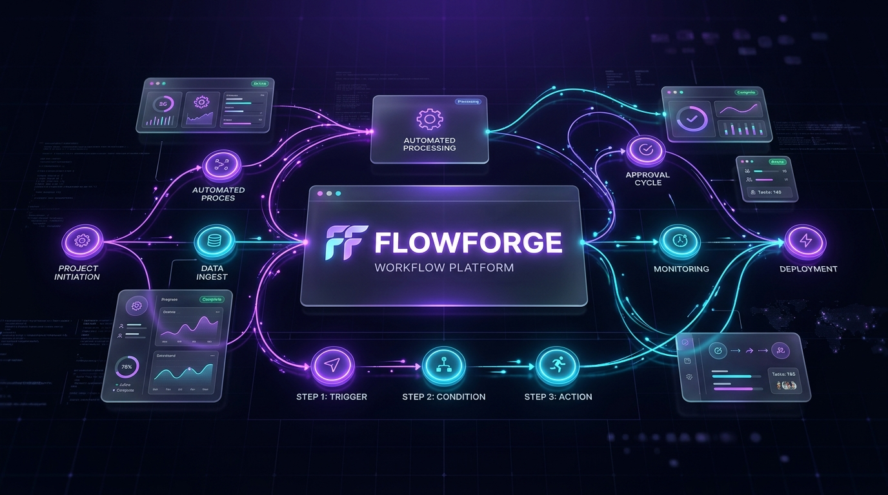

<p align="center">
  
</p>

# ⚡ FLOWFORGE — Enterprise Workflow Orchestration & Team Automation Platform

<p align="left">
  <a href="#-overview"></a>
  <a href="#-license"></a>
  <a href="https://react.dev/"></a>
  <a href="https://reactflow.dev/"></a>
  <a href="https://vitejs.dev/"></a>
</p>
<p align="left">
  <a href="https://tailwindcss.com/"></a>
  <a href="https://nodejs.org/"></a>
  <a href="https://expressjs.com/"></a>
  <a href="https://supabase.com/"></a>
  <a href="https://flow-ferge.vercel.app/"></a>
</p>

A next-generation, full-stack visual workflow automation and DAG orchestration SaaS platform engineered for distributed team management, dynamic dependency graph execution, real-time node synchronization, and enterprise role-based access control.

[Overview](#-overview) • [Key Features](#-key-features) • [Tech Stack](#-technology-stack) • [Architecture](#-system-architecture) • [Database Schema](#-supabase-database-schema) • [RBAC & Permissions](#-rbac--security-model) • [Installation](#-getting-started) • [Deployment](#-production-deployment) • [Contributing](#-contributing) • [License](#-license)

---

## 🌐 Production Environment

| Attribute | Deployment Resource |
| :--- | :--- |
| **Live Production Application** | [https://flow-ferge.vercel.app](https://flow-ferge.vercel.app/) |
| **Backend API Gateway** | Node.js + Express High-Throughput REST API |
| **Database Engine** | Supabase Managed PostgreSQL with Row-Level Security (RLS) |
| **Primary Repository** | [GitHub: hemmanth-18/FlowFerge](https://github.com/hemmanth-18/FlowFerge) |

---

## 📖 Overview

**FlowForge** transforms complex project hierarchies into high-clarity, visual Directed Acyclic Graphs (DAGs). Rather than managing static, disjointed task lists, teams coordinate initiatives using an interactive node-and-edge visual canvas equipped with automated trigger rules, cycle detection, downstream task unlocking, and strict role isolation.

Whether orchestrating software deployment pipelines, content editorial cycles, or cross-functional team sprints, FlowForge provides complete transparency with granular control over who can create, view, execute, and verify work deliverables.

---

## ✨ Key Features

### 🎨 Visual DAG Workflow Canvas
* **Powered by React Flow (`@xyflow/react`)**: Interactive drag-and-drop workspace supporting custom task nodes, status monitors, priority indicators, and animated neon bezier connectors.
* **Intelligent Graph Traversal**: Upstream completion triggers automated activation of downstream dependencies with automated cycle detection.
* **Canvas Task Synchronization**: Node modifications on the canvas seamlessly synchronize with the central team task repository and personal task queues.

### 👥 Multi-Tier Workspace & Team Scoping
* **Team-Centric Organization**: Strict multi-tenant isolation: `Organization` &rarr; `Team` &rarr; `Workflows` &rarr; `Tasks` &rarr; `Automations`.
* **Universal Team Workflow Visibility**: Workflows created by team members are shared across the authorized team while keeping external teams completely isolated.
* **Optional Restrict-to-Selected Mode**: Workflows can optionally be constrained to designated collaborator subsets while remaining private to the parent team.

### 🛡️ Enterprise RBAC & Task Ownership Protection
* **Team Roles**: `TEAM_ADMIN`, `TEAM_MANAGER`, `TEAM_MEMBER`, `TEAM_VIEWER`.
* **Member Access Principle**: Team members have full visibility to inspect workflows and team rosters, but are strictly limited to updating and executing **tasks assigned to them**.
* **View-Only Guardrails**: Members inspecting tasks assigned to others are presented with read-only lock state, preventing unauthorized edits or state alterations.

### ⚡ Event-Driven Automation Engine
* **Configurable Triggers**: Execute actions on `TASK_COMPLETED`, `STATUS_CHANGED`, `WORKFLOW_STARTED`, or `SCHEDULED_INTERVAL`.
* **Dynamic Actions**: Automatic task creation, priority escalation, email alerts, and webhook notifications.
* **Execution Audit Log**: Complete chronological execution history with granular success/failure analytics.

### 📋 Quality Guardrails & Deliverable Verification
* **Mandatory Completion Descriptions**: Enforces minimum 15-word substantive completion notes before tasks can be marked `COMPLETED`.
* **Deliverable Upload Support**: Attach verifiable artifacts (documents, reports, build logs) directly to task nodes upon completion.
* **Audit Trail**: Every status change, assignment, and configuration modification is recorded in the platform audit log.

### 📬 Real-Time Notifications & Email Collaboration
* **In-App Alerts**: Live notification tray with unread indicators and actionable invitation accept/decline workflows.
* **SMTP Email Delivery**: Nodemailer integration with Gmail SMTP for direct email dispatch when invitations and task assignments occur.

---

## 🛠️ Technology Stack

| Layer | Technology | Version | Purpose |
| :--- | :--- | :--- | :--- |
| **Frontend Framework** | React | `18.3.1` | Declarative component UI library |
| **Build & Tooling** | Vite | `6.1.0` | Ultra-fast HMR and bundle compilation |
| **Canvas & DAGs** | React Flow (`@xyflow/react`) | `12.4.2` | Visual node graphing, drag-and-drop workflow canvas |
| **Styling & Design** | Tailwind CSS | `3.4.17` | Utility-first glassmorphism design system |
| **Motion & FX** | Framer Motion | `14.1.0` | Micro-interactions, animated transitions, modals |
| **Iconography** | Lucide React | `0.475.0` | Modern SVG iconography |
| **Routing** | React Router DOM | `6.29.0` | Client-side SPA navigation and route guardrails |
| **HTTP Client** | Axios | `1.7.9` | Intercepted client requests with session tokens |
| **Backend Framework** | Node.js / Express | `4.21.2` | REST API architecture, DAG engines, RBAC middleware |
| **Database** | Supabase PostgreSQL | `2.48.1` | Relational database, foreign keys, RLS policies |
| **Authentication** | Supabase Auth | `Latest` | Token verification, sessions, bcrypt hashing |
| **Security** | Helmet & CORS | `8.0.0` | HTTP security headers and cross-origin resource policy |
| **Email Service** | Nodemailer | `10.1.0` | Automated invite emails via Gmail SMTP |

---

## 🏛️ System Architecture

```text
┌───────────────────────────────────────────────────────────────────────────────────┐
│                                 FLOWFORGE CLIENT                                  │
│                      (React 18 + Vite + Tailwind CSS + Lucide)                    │
└─────────────────────┬───────────────────────────────────────┬─────────────────────┘
                      │                                       │
                      │ REST API & Sessions                   │ Supabase Auth & RLS
                      ▼                                       ▼
┌───────────────────────────────────────────┐   ┌───────────────────────────────────┐
│           EXPRESS BACKEND API             │   │        SUPABASE PLATFORM          │
│       (Node.js + Express Gateway)         │   │       (Managed PostgreSQL)        │
├───────────────────────────────────────────┤   ├───────────────────────────────────┤
│ • Anti-IDOR Authorization Guards          │   │ • Relational Tables with FKs      │
│ • Workflow DAG Validation & Cycles        │◄──┤ • Row Level Security (RLS)        │
│ • Task Synchronization & Assignee Match   │   │ • Token & Session Store           │
│ • Automation Engine & Triggers            │   │ • Realtime WebSocket Events       │
│ • Nodemailer SMTP Gateway                 │   │ • Audit & Activity Event Logs     │
└───────────────────────────────────────────┘   └───────────────────────────────────┘
```

---

## 🗄️ Supabase Database Schema

FlowForge leverages a normalized relational database schema with referential integrity and Row-Level Security:

| Table | Purpose | Primary Fields |
| :--- | :--- | :--- |
| `users` | User accounts and platform profiles | `id`, `email`, `username`, `name`, `avatar_url`, `created_at` |
| `teams` | Workspaces grouping members and resources | `id`, `name`, `description`, `created_by`, `archived` |
| `team_members` | Team membership and permission roles | `team_id`, `user_id`, `role`, `joined_at` |
| `team_invitations` | Pending team invites sent via email | `team_id`, `email`, `role`, `token`, `status` |
| `workflows` | Workflow pipelines and DAG graphs | `id`, `name`, `description`, `team_id`, `created_by`, `status`, `nodes`, `edges`, `is_restricted` |
| `workflow_members` | Collaborator permissions per workflow | `workflow_id`, `user_id`, `role`, `joined_at` |
| `workflow_invitations` | Workflow collaborator invitation states | `workflow_id`, `invited_user_id`, `role`, `status` |
| `tasks` | Actionable tasks synced with canvas nodes | `id`, `workflow_id`, `team_id`, `title`, `description`, `status`, `priority`, `assigned_to`, `due_date` |
| `automations` | Event-driven trigger/action workflow rules | `id`, `workflow_id`, `team_id`, `trigger_type`, `action_type`, `config`, `enabled` |
| `automation_logs` | Execution history of automated runs | `id`, `automation_id`, `status`, `executed_at`, `payload` |
| `notifications` | In-app user notifications and alerts | `id`, `user_id`, `type`, `title`, `message`, `read`, `metadata` |
| `activity_logs` | Team-level event stream | `id`, `team_id`, `workflow_id`, `user_id`, `action`, `details` |
| `audit_logs` | Security and compliance audit history | `id`, `team_id`, `workflow_id`, `user_id`, `action`, `result` |

---

## 🔒 RBAC & Security Model

```
                    ┌────────────────────────────┐
                    │      TEAM_ADMIN / OWNER    │
                    │ Full workspace management, │
                    │ team settings, member roles│
                    └─────────────┬──────────────┘
                                  │
                    ┌─────────────▼──────────────┐
                    │        TEAM_MANAGER        │
                    │ Create & edit workflows,   │
                    │ assign tasks, automations  │
                    └─────────────┬──────────────┘
                                  │
                    ┌─────────────▼──────────────┐
                    │        TEAM_MEMBER         │
                    │ View team & workflows,     │
                    │ EXECUTE ONLY ASSIGNED TASKS│
                    └─────────────┬──────────────┘
                                  │
                    ┌─────────────▼──────────────┐
                    │        TEAM_VIEWER         │
                    │ Read-only observation      │
                    │ across all pipelines       │
                    └────────────────────────────┘
```

* **IDOR Immunity**: All mutations verify that the requesting user belongs to the associated team.
* **Member Task Safeguard**: Non-managers cannot update or delete tasks assigned to other colleagues (`403 Forbidden` enforced at API level and locked in UI).
* **Credential Isolation**: Secret database service-role keys reside exclusively on the server and are never delivered to the client bundle.

---

## 🚀 Getting Started

### Prerequisites
* **Node.js**: `v18.0.0` or higher (Node.js 20+ recommended)
* **npm**: `v9.0.0` or higher
* **Supabase Project**: Active Supabase instance with SQL query editor access

### 1. Clone the Repository
```bash
git clone https://github.com/hemmanth-18/FlowFerge.git
cd FlowFerge
```

### 2. Configure Environment Variables

#### Backend Configuration (`server/.env`)
```env
PORT=5000
NODE_ENV=development
SUPABASE_URL=https://your-project.supabase.co
SUPABASE_SERVICE_ROLE_KEY=your-supabase-service-role-key

# Gmail SMTP Configuration for Real Emails
MAIL_HOST=smtp.gmail.com
MAIL_PORT=465
MAIL_SECURE=true
MAIL_USER=your_email@gmail.com
MAIL_APP_PASSWORD=your_16_character_app_password
APP_BASE_URL=http://localhost:5173
```

#### Frontend Configuration (`client/.env`)
```env
VITE_SUPABASE_URL=https://your-project.supabase.co
VITE_SUPABASE_ANON_KEY=your-supabase-anon-key
VITE_API_URL=http://localhost:5000/api
```

### 3. Database Initialization
Execute the SQL schema in `supabase/schema.sql` inside your Supabase project's **SQL Editor** to establish all tables, relational indexes, and Row Level Security policies.

### 4. Install Dependencies & Launch

```bash
# Terminal 1: Launch Backend Server
cd server
npm install
npm run dev

# Terminal 2: Launch Frontend Client
cd client
npm install
npm run dev
```

* **Client**: Open [http://localhost:5173](http://localhost:5173)
* **Server**: API active at [http://localhost:5000](http://localhost:5000)

---

## 🔑 Demo Evaluation Accounts

| Account | Email | Username | Password | Assigned Role |
| :--- | :--- | :--- | :--- | :--- |
| **Hemmanth** | `hemmanth@example.com` | `hemmanth` | `Password123!` | Platform Admin / Team Owner |
| **Priya** | `priya@example.com` | `priya` | `Password123!` | Workflow Manager Collaborator |
| **Ravi** | `ravi@example.com` | `ravi` | `Password123!` | Multi-Team Developer |
| **Kumar** | `kumar@example.com` | `kumar` | `Password123!` | Marketing Team Member |

---

## 📧 Automated Email Dispatch Setup

FlowForge provides direct email invitations using Gmail SMTP:

1. Enable **2-Step Verification** on your Google Account.
2. Generate an **App Password** under Google Account &rarr; Security &rarr; App passwords (`FlowForge Backend`).
3. Set `MAIL_USER` and `MAIL_APP_PASSWORD` in `server/.env`.
4. Invitations automatically deliver rich HTML invitation emails containing instant accept links.

---

## 🤝 Contributing

Contributions are welcomed! Follow these standard guidelines:

1. **Fork** the repository: `git fork https://github.com/hemmanth-18/FlowFerge.git`
2. **Create a Feature Branch**: `git checkout -b feature/amazing-feature`
3. **Commit Your Changes**: `git commit -m "Add amazing feature"`
4. **Push to Branch**: `git push origin feature/amazing-feature`
5. **Open a Pull Request** describing your additions and test results.

---

## 📄 License

Distributed under the **MIT License**. See `LICENSE` for more information.

<p align="center">
  <sub>Engineered with precision for agile, distributed engineering and operations teams.</sub>
</p>
